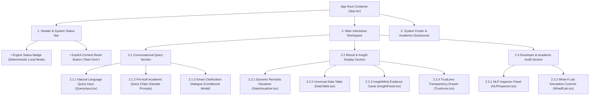
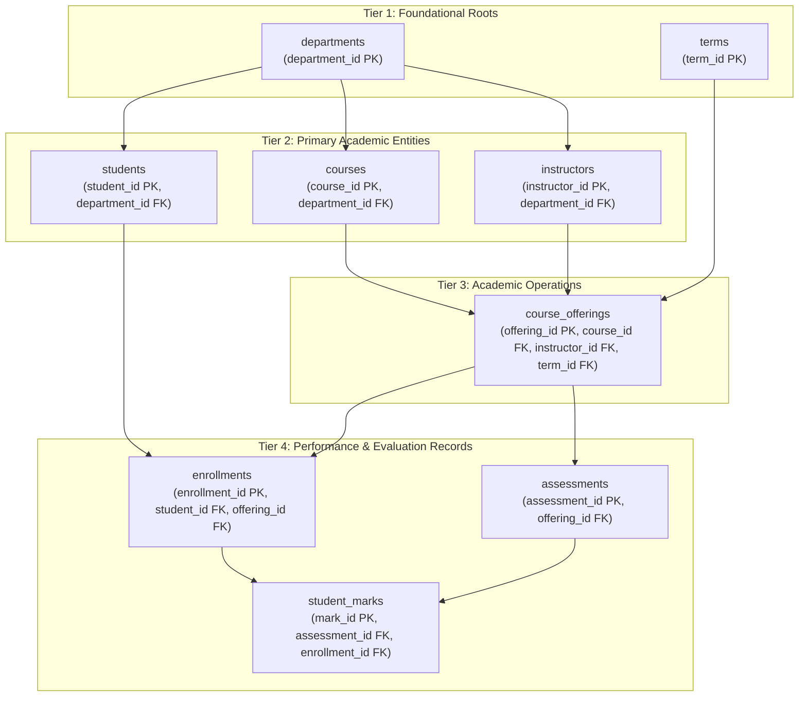
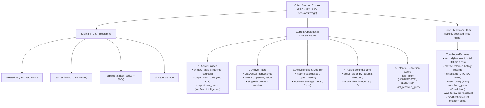
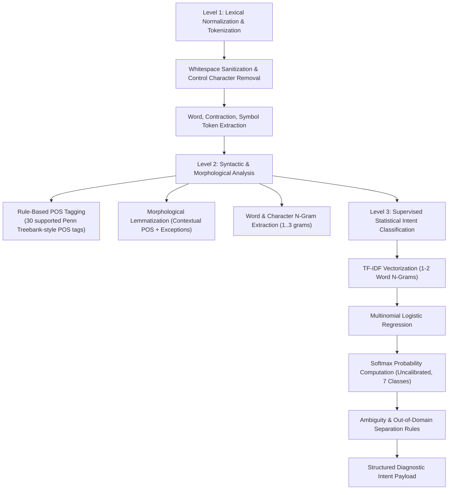
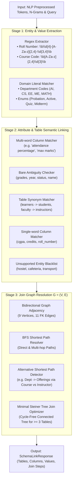

# QueryMind AI 2.0 — Hierarchical Input Design (HID)
*Deliverable Document 2 | Updated — Phase 5 ContextMind Conversational Context Engine*

> **Status:** Phase 5 Implemented & Verified Specification  
> **Phase Milestone:** Phase 5 (ContextMind Multi-Turn State Management)  
> **Note:** This document outlines the hierarchical interaction tree across the frontend application, user input dispatch layers, conversational context frame resolution, relational database data input hierarchies, NLP pipeline processing stages, and Schema Linking & Join Path hierarchies.

---

## 1. Top-Level Application Input Hierarchy

---

## 2. Academic Relational Database Input Hierarchy

The academic entity tree organizes data input, relational dependencies, and foreign key cascades across 4 hierarchical tiers:

### Relational Dependency Invariants:
1. **Root Precedence**: `departments` and `terms` must be seeded prior to any other entities.
2. **Entity Precedence**: `courses`, `instructors`, and `terms` must be established before a `course_offering` can be scheduled.
3. **Evaluation Precedence**: An `enrollment` and an `assessment` must both exist before a `student_mark` can be recorded.

---

## 3. Conversational Context Hierarchy (ContextMind)

### Context Resolution & Slot Merging Hierarchy:
1. **Level 0 (Sanitization & Reset Gate)**: Validates UUID format, checks for explicit reset triggers (`clear context`, `reset`, `start over`). If triggered, immediate frame purge.
2. **Level 1 (Anaphora & Follow-Up Detection)**: Detects pronouns (`their`, `them`, `those`, `these`, `same`), replacement markers (`instead`), and elliptical discourse starters (`now`, `also`, `sort by`). Differentiates independent queries with discourse markers from follow-ups (queries introducing a new entity start a fresh context; pure list queries clear sticky metrics).
3. **Level 2 (Referent Binding & Clarification)**: If pronouns present without active context $\to$ triggers structured clarification. If multiple departments or multiple primary entities are present $\to$ triggers structured clarification (zero arbitrary selection). If context is unambiguous $\to$ binds referents to active entities/filters.
4. **Level 3 (Deterministic Natural Language Synthesis)**: Synthesizes fully qualified, unambiguous standalone query text.
5. **Level 4 (State Merging & Contradiction Resolution)**: Overrides conflicting slots (e.g., department $CS$ overrides $AI$), preserves orthogonal slots, clears sticky metrics on list queries, bounds turn history to 50 turns (`MAX_TURNS_PER_SESSION = 50`), refreshes sliding TTL, and registers for lifespan-managed background cleanup.

---

## 4. NLP Preprocessing & Intent Classification Hierarchy

The Phase 3 NLP processing hierarchy operates in three sequential levels:

---

## 5. Schema Linking & Minimal Join Graph Hierarchy (Level 4)

The Phase 4 Schema Linking layer bridges linguistic intent and physical database relationships:

