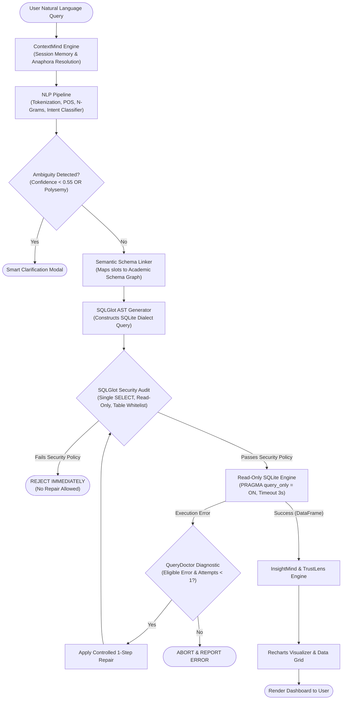
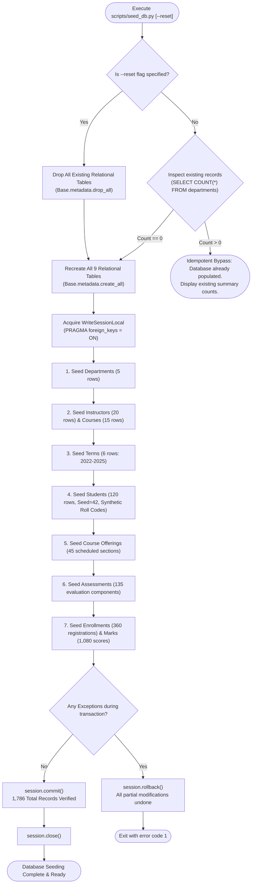
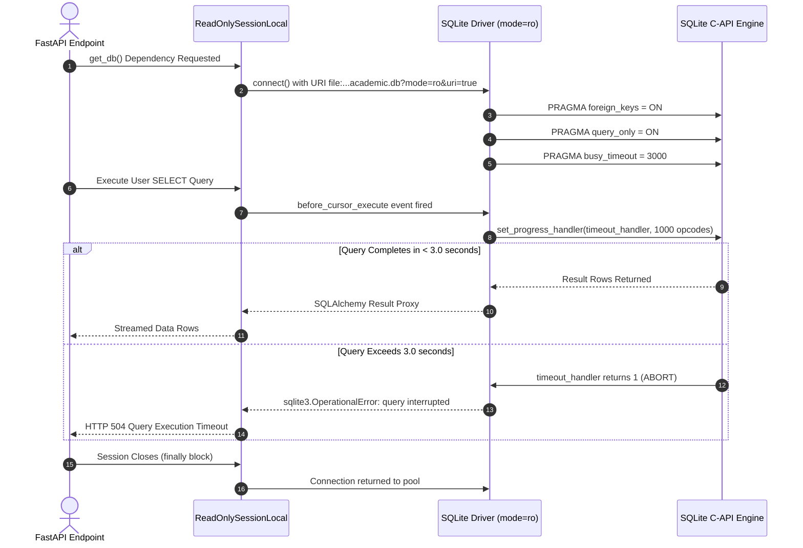
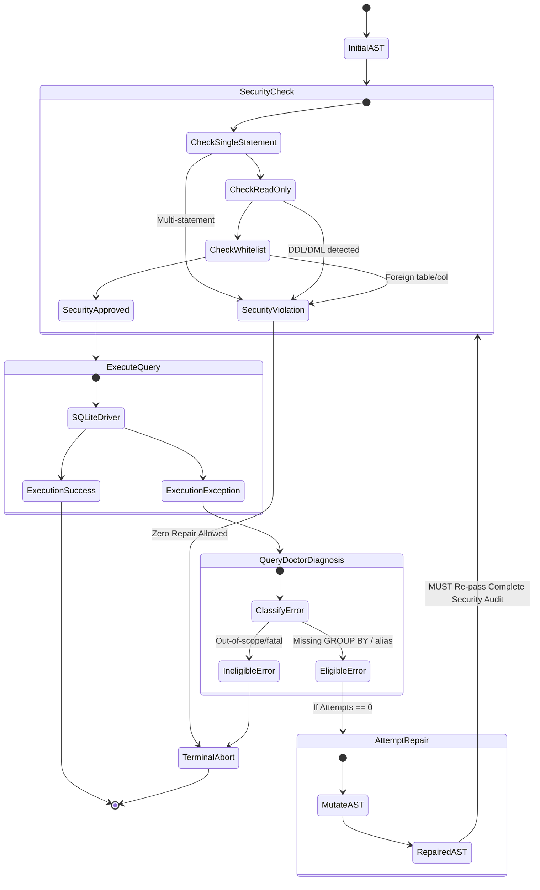
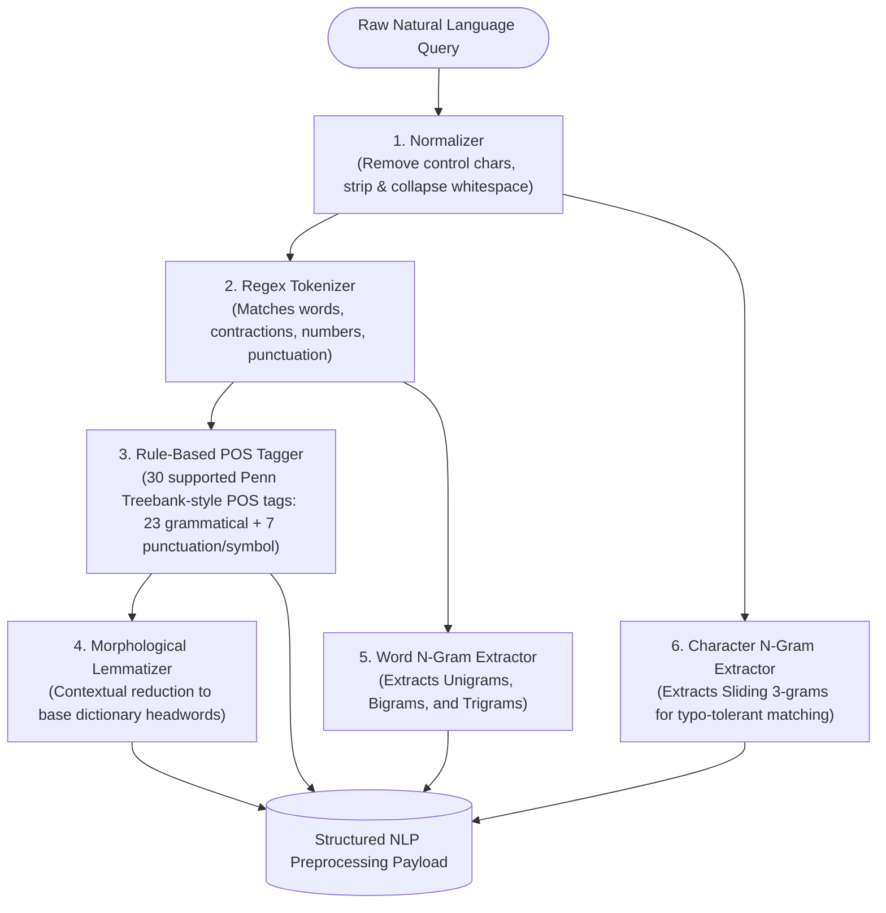
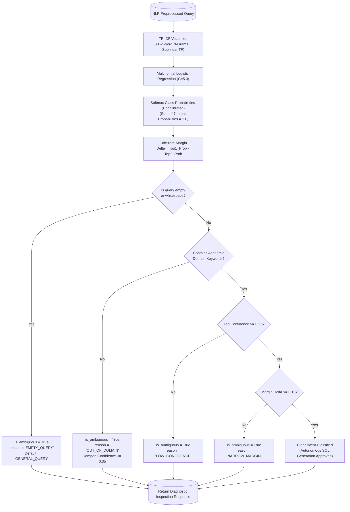
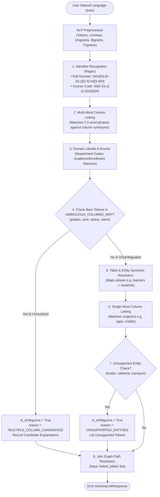

# QueryMind AI 2.0 — Architecture & Process Flowcharts (Flow File)
*Deliverable Document 4 | Updated — Phase 4 Schema Linking & Join Graph Construction*

> **Status:** Phase 4 Approved Process Diagram Specification  
> **Phase Milestone:** Phase 4 (Schema Linking & Join Graph Construction)  
> **Note:** This document provides formal Mermaid diagrams documenting architectural flows, database lifecycles, security execution boundaries, NLP intent classification decision pipelines, and Schema Linking & Steiner Tree Join Graph resolution algorithms.


---

## 1. High-Level System Architecture Flow



---

## 2. Database Initialization & Deterministic Seeding Lifecycle



---

## 3. Hardened Read-Only Connection Lifecycle & Timeout Protection



---

## 4. QueryDoctor Error Repair & Security Isolation Loop



---

## 5. NLP Preprocessing Pipeline Flowchart



---

## 6. Supervised Intent Classification Decision Tree



---

## 7. Semantic Schema Linking Pipeline Flowchart



---

## 8. Foreign-Key Join Graph Adjacency & Steiner Tree Resolver Flowchart

```mermaid
flowchart TD
    TargetTables(["Target Tables Set: T = {t1, t2, ..., tk}"]) --> CountCheck{"Table Count |T|"}
    
    CountCheck -- "|T| == 0" --> EmptyPath["Return Empty Connected Result (0 Hops)"]
    CountCheck -- "|T| == 1" --> SinglePath["Return Anchor Table (0 Hops, No Joins)"]
    
    CountCheck -- "|T| == 2" --> BFS2["Run BFS Shortest Path between (t1, t2)"]
    BFS2 --> MultiPathCheck{"Multiple Shortest<br>Paths of Same Length?"}
    MultiPathCheck -- "Yes" --> SetAltPaths["Primary: Path A<br>Alternative: Path B<br>alternative_paths_count > 0<br>is_ambiguous = True ('MULTIPLE_JOIN_PATHS')"]
    MultiPathCheck -- "No" --> DirectSteps["Construct Ordered Join Steps<br>(1 to 3 hops)"]
    
    CountCheck -- "|T| >= 3" --> SteinerInit["Takahashi-Matsuyama Steiner Tree Heuristic<br>(Over all candidate root anchors r in V)"]
    SteinerInit --> LoopRoots["For each root r, initialize V_tree = {r}, E_tree = []"]
    LoopRoots --> ForEachRoot["While unreached terminals in T:<br>Run Multi-Source BFS from V_tree to nearest terminal"]
    ForEachRoot --> MergeEdges["Add Shortest Path to V_tree & E_tree<br>(Guaranteed Acyclic: |E| == |V| - 1)"]
    MergeEdges --> CycleCheck{"All terminals in T<br>successfully reached?"}
    CycleCheck -- "Yes" --> ScoreTree["Record Total Hops = |E_tree|"]
    CycleCheck -- "No" --> DiscardRoot["Discard Disconnected Candidate"]
    
    ScoreTree --> FindMinTree["Select Candidate Root & Tree with Minimum Total Hops<br>(Preserve alternative distinct minimal trees)"]
    FindMinTree --> OrderSteps["Topologically Order Join Steps Outward from Anchor via BFS"]
    
---

## 9. ContextMind Conversational Context Resolution Flowchart

```mermaid
flowchart TD
    Req(["Incoming Query Request (session_id, query)"]) --> UUIDCheck{"Valid RFC 4122 UUID?"}
    UUIDCheck -- "No" --> Err422(["Raise HTTP 422 Unprocessable Entity"])
    
    UUIDCheck -- "Yes" --> ResetCheck{"Matches Reset Trigger?<br>('clear context', 'reset', 'start over')"}
    ResetCheck -- "Yes" --> PurgeSession["Purge Session Frame from Memory<br>(del _sessions[session_id])"]
    PurgeSession --> EmitReset(["Return ContextResolveResponse<br>(status='reset', was_reset=True)"])
    
    ResetCheck -- "No" --> GetSession["Retrieve Session Frame<br>(with self._lock, sliding TTL check)"]
    GetSession --> ExpiredCheck{"Session Exists &<br>now >= expires_at?"}
    ExpiredCheck -- "Yes (Expired)" --> EvictSession["Evict Expired Frame<br>(del _sessions[session_id])"] --> CreateFresh["Create Clean Session Frame"]
    ExpiredCheck -- "No (Valid)" --> CheckPriorTurn{"turn_count > 0 &<br>active_entities present?"}
    
    CheckPriorTurn -- "No (Fresh Context)" --> CheckPronounFresh{"Query contains<br>anaphoric pronouns?<br>('their', 'them')"}
    CheckPronounFresh -- "Yes" --> EmitClarifyEmpty(["Return Clarification Required<br>(status='clarification', zero prior context)"])
    CheckPronounFresh -- "No" --> ExtractSlots["Extract Slots (all_entities, all_departments, metric, sort, limit)"]
    
    CheckPriorTurn -- "Yes (Active Context)" --> ExtractSlots
    
    ExtractSlots --> MultiDeptCheck{"Multiple Departments?<br>len(all_departments) > 1"}
    MultiDeptCheck -- "Yes" --> EmitClarifyDept(["Return Clarification Required<br>(status='clarification', specify single department)"])
    
    MultiDeptCheck -- "No" --> MultiEntityCheck{"Multiple Primary Entities?<br>len(all_entities) > 1"}
    MultiEntityCheck -- "Yes" --> EmitClarifyEntity(["Return Clarification Required<br>(status='clarification', specify single entity)"])
    
    MultiEntityCheck -- "No" --> DetectFollowUp{"Is Follow-Up Query?<br>• Pronouns ('their', 'them', 'those')<br>• Replacement ('instead')<br>• Same department<br>• Not new entity topic shift<br>• Not independent list query"}
    
    DetectFollowUp -- "No (Topic Shift / New Query)" --> ResetActiveSlots["Re-initialize Active Context Slots<br>(resolved_query stripped of discourse markers,<br>was_follow_up=False, sticky metrics cleared)"]
    
    DetectFollowUp -- "Yes (Follow-Up)" --> AnaphoraSynthesize["Deterministic Anaphora Resolution & Natural Language Synthesis<br>• 'their attendance' -> 'Show attendance of students in AI'<br>• 'sort them by credits' -> 'Show courses in CS sorted by credits'<br>• 'CS students instead' -> 'Show average CGPA of CS students'"]
    
    AnaphoraSynthesize --> SlotMerge["Context Slot Merging & Contradiction Resolution<br>• Dept override: new dept replaces old dept (expunges old filter)<br>• Metric update: new metric updates active_metric<br>• List query: clears active_metric to None<br>• Orthogonal preservation: unrelated filters/entities preserved"]
    
    SlotMerge --> ClassifyIntent["Classify Intent of Resolved Query via IntentClassifier"]
    ResetActiveSlots --> ClassifyIntent
    
    ClassifyIntent --> IncrementTurns["Monotonically Increment turn_count += 1"]
    IncrementTurns --> AppendAudit["Append TurnRecord to turn_history Stack<br>Trim: retain only last 50 turns (MAX_TURNS_PER_SESSION = 50)"]
    AppendAudit --> RefreshTTL["Persist Frame & Refresh Sliding TTL<br>(last_active = now, expires_at = now + 600s)"]
    RefreshTTL --> FinalResponse(["Return ContextResolveResponse<br>(status='success', resolved_query, active_frame)"])
```


