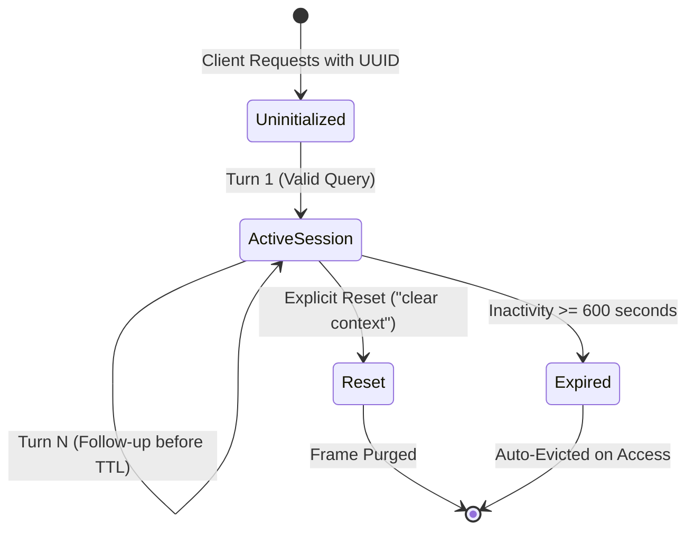

# QueryMind AI 2.0 — ContextMind Conversational Context Engine Architecture

## 1. Overview and Architectural Purpose

In the QueryMind AI 2.0 text-to-SQL architecture, **Phase 5: ContextMind — Conversational Context Engine & Multi-Turn State Management** serves as the deterministic, rule-based conversational memory layer. It enables the system to maintain conversational state across multi-turn user dialogs, resolve anaphoric pronouns and follow-up queries, preserve relevant filters, eliminate contradictory slots, enforce sliding time-to-live (TTL) expiration, and manage thread-safe session isolation—completely offline and without reliance on non-deterministic external LLMs.

```
                              [ User Query (Turn N) ]
                                         │
                                         ▼
                 ┌───────────────────────────────────────────────┐
                 │       Phase 5: ContextMind Context Engine     │
                 ├───────────────────────────────────────────────┤
                 │ 1. Session Retrieval & Sliding TTL Validation │
                 │ 2. Explicit Reset Detection ("clear context") │
                 │ 3. Anaphora & Follow-Up Detector ("their",    │
                 │    "them", "instead", "sort by", "top 5")     │
                 │ 4. Unresolvable Referent Guard (Clarification)│
                 │ 5. Slot Merging & Contradiction Elimination   │
                 │ 6. Deterministic Natural Language Synthesis   │
                 │ 7. Audit History Recording & State Persistence│
                 └───────────────────────────────────────────────┘
                                         │
                                         ▼
                       [ Unambiguous Resolved Standalone Query ]
                                         │
                                         ▼
                      [ Phase 3: NLP Preprocessor & Classifier ]
                                         │
                                         ▼
                      [ Phase 4: Semantic Schema Linker & Graph ]
                                         │
                                         ▼
                      [ Phase 6: Text-to-SQL Generator (Planned) ]
```

---

## 2. Explicit Structured Context Frame

To eliminate hallucination and state corruption, ContextMind replaces unstructured conversational text accumulation with an explicit, strongly-typed Context Frame:

$$\text{Active Context Frame} = \langle \mathcal{E}, \mathcal{F}, \mathcal{M}, \mathcal{G}, \mathcal{O}, \mathcal{L}, \mathcal{I}, \mathcal{H}, \text{TTL} \rangle$$

### Conceptual Frame Components
- **$\mathcal{E}$ (Active Entities)**: Dictionary of active academic entities (e.g., `primary_table="students"`, `department_code="AI"`, `department_name="Artificial Intelligence"`).
- **$\mathcal{F}$ (Active Filters)**: List of active SQL filters (`column`, `operator`, `value`), such as `departments.code = 'AI'`.
- **$\mathcal{M}$ (Active Metric)**: Analytical or aggregation metric (e.g., `attendance`, `cgpa`, `marks`, `credits`).
- **$\mathcal{G}$ (Active Grouping)**: Relational attributes designated for aggregation grouping (`departments.name`, `terms.term_name`).
- **$\mathcal{O}$ (Active Order By)**: Ordering attribute and direction (`column`, `direction: ASC | DESC`).
- **$\mathcal{L}$ (Active Limit)**: Row limit for ranking queries (`int`, e.g., 5 or 10).
- **$\mathcal{I}$ (Last Intent)**: The intent classification of the resolved query (`AGGREGATE`, `RANKING`, `FILTER`, `COMPARISON`, `TREND`, `GENERAL_QUERY`).
- **$\mathcal{H}$ (Turn History)**: Sequential audit stack of conversational turns with user inputs, resolved outputs, intents, and slot modification deltas, strictly bounded to the most recent 50 turns (`MAX_TURNS_PER_SESSION = 50`).
- **`turn_count`**: Monotonically increasing lifetime turn counter tracking the total number of interactions in the session, independent of history trimming.
- **$\text{TTL}$ (Time-to-Live Window)**: Configurable sliding window (`CONTEXT_TTL_SECONDS = 600`, default 10 minutes) with RFC 3339 timestamps (`created_at`, `last_active`, `expires_at`).

### JSON Serialization Example
```json
{
  "session_id": "3fa85f64-5717-4562-b3fc-2c963f66afa6",
  "created_at": "2026-11-07T10:30:00Z",
  "last_active": "2026-11-07T10:32:15Z",
  "expires_at": "2026-11-07T10:42:15Z",
  "ttl_seconds": 600,
  "turn_count": 2,
  "active_entities": {
    "primary_table": "students",
    "department_code": "AI",
    "department_name": "Artificial Intelligence"
  },
  "active_filters": [
    {
      "column": "departments.code",
      "operator": "=",
      "value": "AI"
    }
  ],
  "active_metric": "attendance",
  "active_group_by": [],
  "active_order_by": null,
  "active_limit": null,
  "last_intent": "AGGREGATE",
  "last_query": "Now show their attendance.",
  "last_resolved_query": "Show attendance of students in the AI department.",
  "turn_history": [
    {
      "turn_id": 1,
      "timestamp": "2026-11-07T10:30:00Z",
      "user_query": "Show students in the AI department.",
      "resolved_query": "Show students in the AI department.",
      "intent": "GENERAL_QUERY",
      "was_follow_up": false,
      "modifications": {"action": "new_topic_initialized"}
    },
    {
      "turn_id": 2,
      "timestamp": "2026-11-07T10:32:15Z",
      "user_query": "Now show their attendance.",
      "resolved_query": "Show attendance of students in the AI department.",
      "intent": "AGGREGATE",
      "was_follow_up": true,
      "modifications": {
        "entity_preserved": "students",
        "department_preserved": "AI",
        "metric_updated": {"old": null, "new": "attendance"}
      }
    }
  ]
}
```

---

## 3. Session Management & Sliding TTL Lifecycle

### Architectural Guarantees
1. **Volatile In-Memory Storage**: Session contexts are stored exclusively in an in-memory dictionary (`Dict[str, ContextFrameSchema]`). Zero external databases (no Redis, no SQLite persistence) are utilized for conversational state. A server restart cleanly resets all session memory.
2. **Strict Session Isolation**: Every session is identified by a client-provided RFC 4122 UUID (`session_id`). Queries and state mutations executed under Session $A$ are completely inaccessible and invisible to Session $B$.
3. **Thread Safety**: All dictionary reads, writes, and evictions are enclosed in a re-entrant lock (`threading.RLock`), supporting high-concurrency multi-threaded HTTP requests without race conditions or memory corruption.
4. **Dual Eviction Mechanism (Sliding TTL + Lifespan Background Task)**:
   - Configured via `Settings.CONTEXT_TTL_SECONDS = 600` (default 10 minutes) and `Settings.SESSION_CLEANUP_INTERVAL_SECONDS = 60` (default 60 seconds).
   - **Lazy On-Access Eviction**: When any session is queried, its expiration timestamp is checked against current time. If $t \ge t_{\text{expires}}$, it is evicted immediately. An expired session can never be returned as valid between background cycles.
   - **Periodic Proactive Cleanup**: A single asynchronous background worker managed by FastAPI's `lifespan` context manager periodically purges abandoned expired sessions from memory every 60 seconds, preventing unbounded memory accumulation.
   - **Sliding Window Refresh**: When a session executes a turn at timestamp $t_{\text{now}}$, its expiration timestamp is refreshed:
     $$t_{\text{expires}} = t_{\text{now}} + \text{TTL}$$
5. **Bounded Memory Footprint**: To eliminate unbounded memory growth in long-running conversational sessions, `frame.turn_history` is bounded to `MAX_TURNS_PER_SESSION = 50`. Only the most recent 50 turn records are retained in memory. `turn_count` monotonically tracks total lifetime turns without truncation, and trimming never affects active context slots.
6. **Deterministic Testing**: SessionManager provides an injectable clock provider (`Callable[[], float] = time.time`). Unit tests simulate hours of passage in milliseconds without thread sleeping (`time.sleep()`).



---

## 4. Anaphora & Follow-Up Resolution Engine

ContextMind resolves elliptical and anaphoric follow-up queries using deterministic pattern-matching, morphological token analysis, and relational schema awareness.

### Supported Reference Triggers
- **Pronouns & Determiners**: `"their"`, `"them"`, `"those"`, `"these"`, `"that"`, `"this"`, `"same"`, `"the same"`.
- **Discourse Connectors**: `"now"`, `"also"`, `"and"`, `"then"`, `"instead"`, `"what about"`, `"how about"`.
- **Elliptical Directive Verbs**: `"sort by"`, `"order by"`, `"top \d+"`, `"limit to \d+"`.

### Core Benchmark Resolution Patterns

#### Example A: Anaphoric Possessive Pronoun (`their attendance`)
- **Turn 1**: *"Show students in the AI department."*
  - Active Entity: `students`, Active Filter: `departments.code = 'AI'`.
- **Turn 2**: *"Now show their attendance."*
  - Anaphora: `"their"` binds to active entity `students` in the `AI` department.
  - New Metric: `attendance` (column `enrollments.attendance_percentage`).
  - **Resolved Output**: *"Show attendance of students in the AI department."*
  - **Intent**: `AGGREGATE`.

#### Example B: Anaphoric Objective Pronoun with Sorting (`sort them by credits`)
- **Turn 1**: *"Show courses in the CS department."*
  - Active Entity: `courses`, Active Filter: `departments.code = 'CS'`.
- **Turn 2**: *"Sort them by credits."*
  - Anaphora: `"them"` binds to active entity `courses` in the `CS` department.
  - New Sorting: column `courses.credits`, direction `ASC`.
  - **Resolved Output**: *"Show courses in the CS department sorted by credits."*
  - **Intent**: `RANKING`.

#### Example C: Entity / Department Replacement (`CS students instead`)
- **Turn 1**: *"Show average CGPA of AI students."*
  - Active Entity: `students`, Active Department: `AI`, Active Metric: `cgpa`.
- **Turn 2**: *"Now show CS students instead."*
  - Replacement: `"instead"` triggers slot substitution.
  - Department Slot: `CS` overrides `AI`.
  - Preserved Parameters: Metric `average CGPA` and entity `students` are retained.
  - Contradiction Guard: `AI` filter is completely expunged; only `CS` remains.
  - **Resolved Output**: *"Show average CGPA of CS students."*
  - **Intent**: `AGGREGATE`.

#### Example D: Anaphoric Demonstrative (`those courses with credits > 3`)
- **Turn 1**: *"Show courses in the CS department."*
- **Turn 2**: *"Show those courses with credits greater than 3."*
  - Anaphora: `"those courses"` resolves to courses in the CS department.
  - **Resolved Output**: *"Show courses in the CS department with credits greater than 3."*
  - **Intent**: `FILTER`.

#### Example E: Recurrent Entity Binding (`the same department`)
- **Turn 1**: *"Show courses in the AI department."*
- **Turn 2**: *"Show instructors in the same department."*
  - Anaphora: `"the same department"` binds to `AI department`.
  - **Resolved Output**: *"Show instructors in the AI department."*
  - **Intent**: `GENERAL_QUERY`.

#### Example F: Unresolvable Pronoun Fallback (Zero Hallucination Guard)
- **Turn 1**: (Session clean, empty, or reset)
- **Turn 2**: *"Now show their attendance."*
  - Anaphora: `"their"` has no referent entity in memory.
  - **System Action**: Refuses to guess or hallucinate.
  - **Response Status**: `clarification`.
  - **User Prompt**: *"I could not resolve the reference 'their' because there is no prior conversational context. Please specify which entity (e.g., students, courses, or instructors) you are referring to."*

#### Example G: Multiple Explicit Departments Guard
- **Turn 1**: *"Show courses in AI and CS departments."*
  - Multiple Departments: Query explicitly targets both `'AI'` and `'CS'`.
  - **System Action**: Refuses to silently discard or arbitrarily select one.
  - **Response Status**: `clarification` (`clarification_needed=True`).
  - **User Prompt**: *"Your query specifies multiple departments ('AI', 'CS'). QueryMind AI evaluates one department at a time. Please clarify which department you want to query."*

#### Example H: Multiple Primary Entities Guard
- **Turn 1**: *"Show students and instructors in the AI department."*
  - Multiple Entities: Query references both `'students'` and `'instructors'`.
  - **System Action**: Refuses to silently discard secondary entities.
  - **Response Status**: `clarification` (`clarification_needed=True`).
  - **User Prompt**: *"Your query references multiple entities ('instructors', 'students'). QueryMind AI operates on a single primary entity per turn. Please query one entity at a time."*

#### Example I: Independent Query with Discourse Connector vs Sticky Metric
- **Turn 1**: *"Show average CGPA of AI students."* (Active Entity: `students`, Department: `AI`, Metric: `cgpa`)
- **Turn 2**: *"Now list CS students."*
  - Discourse Starter: Begins with conversational connector `"Now"`, but is a complete, independent list query.
  - **System Action**: Initializes fresh context for `students` in `CS`.
  - **Sticky Metric Invariant**: The aggregation metric `cgpa` is immediately cleared to `None`.
  - **Resolved Output**: *"List CS students."*
  - **Intent**: `FILTER`.

---

## 5. Context Merging & Contradiction Elimination Rules

When resolving follow-ups, ContextMind applies a formal slot modification matrix:

| Slot Type | Condition in Turn $N$ | System Action | Preserved Context | Contradiction Guard |
| :--- | :--- | :--- | :--- | :--- |
| **Department** | Explicit new department (`"CS"`) | Overwrites `department_code` and `department_name` | Metric, Sorting, Limits | **Old department filter expunged**; single department enforced |
| **Department** | Unmentioned in Turn $N$ | Preserves existing department filter | Existing filters | Previous filter remains active |
| **Multiple Depts** | Explicit multiple departments (`"AI and CS"`) | Returns `clarification` | Active frame preserved | **Zero arbitrary selection**; user prompted to clarify |
| **Multiple Entities** | Explicit multiple entities (`"students and instructors"`) | Returns `clarification` | Active frame preserved | **Zero arbitrary selection**; single entity enforced |
| **Metric** | Explicit new metric (`"attendance"`) | Replaces `active_metric` | Entity, Department, Limits | Old metric replaced |
| **Metric** | Unmentioned in Turn $N$ | Preserves existing metric (`"cgpa"`) | All other active slots | Preserved across replacement turns (`"instead"`) |
| **List Query** | Pure list query without metric (`"Now list CS students"`) | Clears `active_metric = None` | Entity, Department | **Sticky metric cleared**; no aggregation bleed |
| **Sort Order** | Explicit sort instruction (`"sort by credits"`) | Sets `active_order_by` | Entity, Department, Metric | Previous sort instruction overridden |
| **Limit** | Explicit limit (`"top 5"`, `"limit 10"`) | Sets `active_limit = N` | Entity, Department, Metric | Previous limit overridden |
| **Topic Shift** | Connector with new entity (`"Now show instructors..."`) | Re-initializes active frame | Sequential `turn_history` | **Previous entity & filters expunged**; fresh context |
| **New Topic** | Independent query without pronouns/connectors | Re-initializes active frame | Sequential `turn_history` | Previous query filters reset |

---

## 6. Context Reset Architecture

### Reset Triggers
- Regex matching:
  $$\wedge\backslash s*(\text{clear context} \mid \text{reset context} \mid \text{reset} \mid \text{start over} \mid \text{start a new query} \mid \text{new query})\backslash s*[.?!]*\$$
- Case-insensitive, whitespace-tolerant.

### Reset Behavior
1. **Immediate Purge**: The active `ContextFrameSchema` associated with the requesting `session_id` is immediately excised from memory.
2. **Session Isolation Invariant**: Resetting Session $A$ has zero impact on Session $B$.
3. **API Confirmation**: Returns a structured confirmation payload with `status="reset"` and `was_reset=True`.
4. **Programmatic Reset**: Service-level method `context_engine.reset_session(session_id)` and HTTP endpoint `POST /api/context/reset/{session_id}` provide clean external controls.

---

## 7. FastAPI Endpoint Specifications (`/api/context`)

ContextMind is mounted under `/api/context` with three primary REST endpoints:

### 7.1 POST `/api/context/resolve`
Resolves an incoming query or follow-up against the conversational session.

- **Request Payload (`ContextResolveRequest`)**:
  ```json
  {
    "session_id": "3fa85f64-5717-4562-b3fc-2c963f66afa6",
    "query": "Now show their attendance."
  }
  ```
- **Response Payload (`ContextResolveResponse`)**:
  ```json
  {
    "status": "success",
    "session_id": "3fa85f64-5717-4562-b3fc-2c963f66afa6",
    "original_query": "Now show their attendance.",
    "resolved_query": "Show attendance of students in the AI department.",
    "was_follow_up": true,
    "was_reset": false,
    "active_frame": { ... },
    "clarification_needed": false,
    "clarification_message": null,
    "turn_number": 2
  }
  ```

### 7.2 GET `/api/context/frame/{session_id}`
Retrieves the active structured Context Frame for diagnostic inspection or frontend synchronization.

- **Response Payload (`ContextFrameResponse`)**:
  ```json
  {
    "status": "success",
    "session_id": "3fa85f64-5717-4562-b3fc-2c963f66afa6",
    "active_frame": { ... },
    "is_expired": false
  }
  ```
- **Error Codes**:
  - `404 Not Found`: Session does not exist or has expired past TTL.
  - `422 Unprocessable Entity`: Malformed session UUID string.

### 7.3 POST `/api/context/reset/{session_id}`
Explicit programmatic reset purging the session frame from memory.

- **Response Payload (`ContextResetResponse`)**:
  ```json
  {
    "status": "success",
    "session_id": "3fa85f64-5717-4562-b3fc-2c963f66afa6",
    "message": "Context for session '3fa85f64-5717-4562-b3fc-2c963f66afa6' has been reset successfully."
  }
  ```

---

## 8. Verification & Test Suite Summary

ContextMind is verified by **42 dedicated automated unit, integration, and concurrency tests** in `backend/tests/test_context_engine.py`:

| Test Category | Test Functions | Verification Focus |
| :--- | :---: | :--- |
| **Session Isolation & Management** | 6 | Multi-session independence, independent state frames, cleanup of expired sessions, background worker, UUID validation |
| **Lifespan Background Task & Cleanup** | 3 | Single-task creation, repeated entry deduplication, sequential cycle teardown, zero orphaned tasks, configurable 60s interval |
| **Sliding TTL & Expiration** | 2 | Zero-sleep deterministic clock advancement, sliding window refresh upon valid turns, post-TTL eviction |
| **Anaphora & Follow-Up Resolution** | 11 | Examples A, B, C; demonstratives (`those`), reciprocal references (`same department`), limit/sort combinations, discourse marker topic shifts ("Now", "And", "Then") |
| **Contradiction Elimination** | 3 | Single-department invariant, contradictory filter replacement, non-contradictory metric preservation, list query metric clearing |
| **Ambiguity & Clarification** | 4 | Unresolvable pronoun handling (`their`, `them`), multiple departments guard, multiple entities guard |
| **Reset Behavior** | 3 | Explicit reset triggers (`clear context`, `reset`, `start over`), programmatic resets, turn history audit stack |
| **Memory Bounding** | 1 | Strict 50-turn history cap (`MAX_TURNS_PER_SESSION = 50`) with monotonic lifetime `turn_count` tracking |
| **Concurrency & Thread Safety** | 1 | Multi-threaded execution (`ThreadPoolExecutor`, 10 concurrent sessions, 5 worker threads) |
| **FastAPI HTTP Endpoints** | 9 | `/resolve`, `/frame/{id}`, `/reset/{id}`, 404 on expired/uninitialized, 422 on invalid UUID or empty query |

**Backend Regression Baseline**:
- Existing Phase 1–4 Tests: **89 passed**
- ContextMind Tests (Phase 5): **42 passed**
- Total Backend Suite: **131 passed in 7.16s (100%)**
- Frontend Production Build: **Passed in 5.21s (0 errors)**

