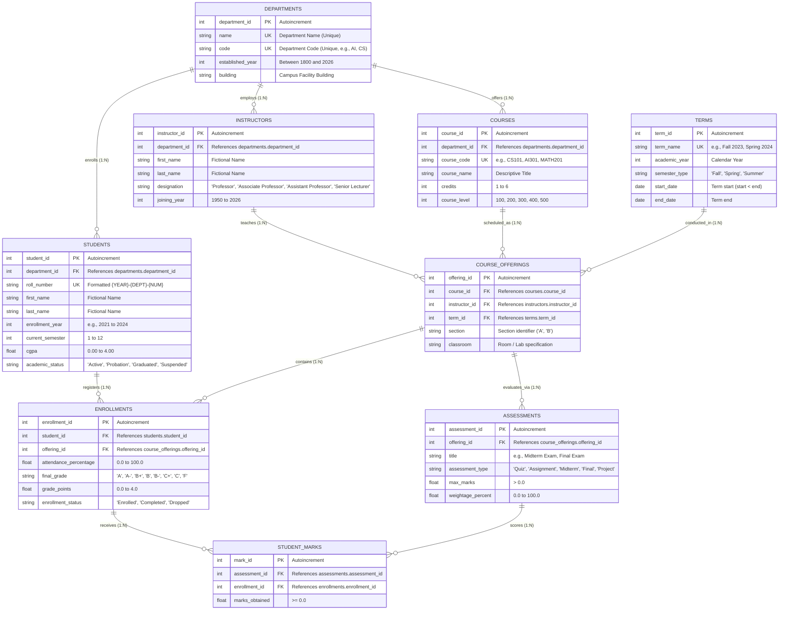

# QueryMind AI 2.0 — Academic Database Architecture & Data Dictionary

**Document Version:** 2.0.0  
**Phase Milestone:** Phase 2 (Academic Database Schema, Models & Deterministic Seeding)  
**Database Engine:** SQLite 3 (SQLAlchemy 2.x ORM)  
**Storage Location:** `backend/data/academic.db` (Excluded from VCS via `.gitignore`)

---

## 1. Architectural Overview & Security Boundaries

QueryMind AI 2.0 enforces a strict architectural boundary between setup/seeding operations and application runtime execution:

```
┌────────────────────────────────────────────────────────────────────────┐
│                   PHASE A: SETUP & SEEDING UTILITIES                   │
│   (scripts/init_db.py, scripts/seed_db.py, test harnesses)             │
│                                                                        │
│   • Write-enabled SQLite connection (sqlite:///backend/data/academic.db)│
│   • Enforces PRAGMA foreign_keys = ON                                  │
│   • Rebuilds/seeds deterministic synthetic academic records            │
│   • Closed immediately upon job completion                             │
└──────────────────────────────────┬─────────────────────────────────────┘
                                   │ Generates persistent DB file
                                   ▼
┌────────────────────────────────────────────────────────────────────────┐
│                    DATABASE FILE (data/academic.db)                    │
│   • 9 Normalized Relational Tables (1,786 total seed rows)             │
│   • Foreign Key constraints & ON DELETE CASCADE                        │
│   • Performance Indexes on IDs, roll numbers, codes, dates, and CGPA   │
└──────────────────────────────────┬─────────────────────────────────────┘
                                   │ Read-Only Connection
                                   ▼
┌────────────────────────────────────────────────────────────────────────┐
│               PHASE B: HARDENED APPLICATION RUNTIME ENGINE             │
│   (Future FastAPI query endpoints, NLP, and analytical services)       │
│                                                                        │
│   • URI Read-Only Mode: sqlite:///file:.../academic.db?mode=ro&uri=true │
│   • Hardware PRAGMA query_only = ON (aborts any INSERT/UPDATE/DELETE)  │
│   • PRAGMA foreign_keys = ON & PRAGMA busy_timeout = 3000              │
│   • Native SQLite C-API progress handler 3.0s query timeout            │
│   • Zero write permissions or general write engines available          │
└────────────────────────────────────────────────────────────────────────┘
```

---

## 2. Entity Relationship Diagram (ERD)



---

## 3. Data Dictionary

### Table 1: `departments`
Stores academic department units.

| Column | Data Type | Nullable | Constraints & Index | Description |
| :--- | :--- | :--- | :--- | :--- |
| `department_id` | `INTEGER` | `NO` | `PRIMARY KEY AUTOINCREMENT` | Unique internal identifier. |
| `name` | `VARCHAR(100)`| `NO` | `UNIQUE`, `INDEX` | Full department name. |
| `code` | `VARCHAR(10)` | `NO` | `UNIQUE`, `INDEX` | Short acronym (e.g., `AI`, `CS`, `EE`). |
| `established_year` | `INTEGER` | `NO` | `CHECK(year BETWEEN 1800 AND 2026)` | Foundation year. |
| `building` | `VARCHAR(50)` | `NO` | None | Primary building facility. |

### Table 2: `students`
Stores student records and cumulative performance indicators.

| Column | Data Type | Nullable | Constraints & Index | Description |
| :--- | :--- | :--- | :--- | :--- |
| `student_id` | `INTEGER` | `NO` | `PRIMARY KEY AUTOINCREMENT` | Unique student record ID. |
| `department_id` | `INTEGER` | `NO` | `FOREIGN KEY (departments) ON DELETE CASCADE`, `INDEX` | Associated department. |
| `roll_number` | `VARCHAR(20)` | `NO` | `UNIQUE`, `INDEX` | Synthetic roll code: `{YEAR}-{DEPT}-{NUM:03d}`. |
| `first_name` | `VARCHAR(50)` | `NO` | None | Fictional first name. |
| `last_name` | `VARCHAR(50)` | `NO` | None | Fictional family name. |
| `enrollment_year`| `INTEGER` | `NO` | `INDEX` | Year admitted (e.g. 2021..2024). |
| `current_semester`| `INTEGER` | `NO` | `CHECK(semester BETWEEN 1 AND 12)` | Active semester level. |
| `cgpa` | `FLOAT` | `NO` | `CHECK(cgpa BETWEEN 0.00 AND 4.00)`, `INDEX` | Cumulative Grade Point Average. |
| `academic_status`| `VARCHAR(20)`| `NO` | `CHECK(status IN ('Active','Probation','Graduated','Suspended'))` | Academic standing. |

### Table 3: `instructors`
Stores academic faculty and instructional personnel.

| Column | Data Type | Nullable | Constraints & Index | Description |
| :--- | :--- | :--- | :--- | :--- |
| `instructor_id` | `INTEGER` | `NO` | `PRIMARY KEY AUTOINCREMENT` | Unique instructor identifier. |
| `department_id` | `INTEGER` | `NO` | `FOREIGN KEY (departments) ON DELETE CASCADE`, `INDEX` | Parent department. |
| `first_name` | `VARCHAR(50)` | `NO` | None | Fictional first name. |
| `last_name` | `VARCHAR(50)` | `NO` | None | Fictional family name. |
| `designation` | `VARCHAR(50)` | `NO` | `CHECK(designation IN ('Professor','Associate Professor','Assistant Professor','Senior Lecturer','Lecturer'))` | Academic position. |
| `joining_year` | `INTEGER` | `NO` | `CHECK(year BETWEEN 1950 AND 2026)` | Appointment year. |

### Table 4: `courses`
Stores the curriculum course catalogue.

| Column | Data Type | Nullable | Constraints & Index | Description |
| :--- | :--- | :--- | :--- | :--- |
| `course_id` | `INTEGER` | `NO` | `PRIMARY KEY AUTOINCREMENT` | Unique course record ID. |
| `department_id` | `INTEGER` | `NO` | `FOREIGN KEY (departments) ON DELETE CASCADE`, `INDEX` | Offering department. |
| `course_code` | `VARCHAR(20)` | `NO` | `UNIQUE`, `INDEX` | Course catalogue code (e.g. `CS101`, `AI301`). |
| `course_name` | `VARCHAR(100)`| `NO` | `INDEX` | Descriptive course title. |
| `credits` | `INTEGER` | `NO` | `CHECK(credits BETWEEN 1 AND 6)` | Credit hours assigned. |
| `course_level` | `INTEGER` | `NO` | `CHECK(course_level IN (100, 200, 300, 400, 500))` | Academic difficulty tier. |

### Table 5: `terms`
Stores calendar academic semesters.

| Column | Data Type | Nullable | Constraints & Index | Description |
| :--- | :--- | :--- | :--- | :--- |
| `term_id` | `INTEGER` | `NO` | `PRIMARY KEY AUTOINCREMENT` | Unique term record ID. |
| `term_name` | `VARCHAR(50)` | `NO` | `UNIQUE`, `INDEX` | Term title (e.g. `Fall 2024`). |
| `academic_year` | `INTEGER` | `NO` | `INDEX` | Academic calendar year. |
| `semester_type` | `VARCHAR(20)` | `NO` | `CHECK(semester_type IN ('Fall', 'Spring', 'Summer'))` | Semester category. |
| `start_date` | `DATE` | `NO` | `CHECK(start_date < end_date)` | Term inception date. |
| `end_date` | `DATE` | `NO` | None | Term conclusion date. |

### Table 6: `course_offerings`
Stores section schedules for courses in specific terms.

| Column | Data Type | Nullable | Constraints & Index | Description |
| :--- | :--- | :--- | :--- | :--- |
| `offering_id` | `INTEGER` | `NO` | `PRIMARY KEY AUTOINCREMENT` | Unique offering instance ID. |
| `course_id` | `INTEGER` | `NO` | `FOREIGN KEY (courses) ON DELETE CASCADE`, `INDEX` | Course scheduled. |
| `instructor_id` | `INTEGER` | `NO` | `FOREIGN KEY (instructors) ON DELETE CASCADE`, `INDEX` | Instructor assigned. |
| `term_id` | `INTEGER` | `NO` | `FOREIGN KEY (terms) ON DELETE CASCADE`, `INDEX` | Term scheduled in. |
| `section` | `VARCHAR(10)` | `NO` | Combined `UNIQUE(course_id, term_id, section)` | Section letter (`A`, `B`). |
| `classroom` | `VARCHAR(50)` | `NO` | None | Assigned lecture hall / laboratory. |

### Table 7: `enrollments`
Stores student registrations and outcomes in course offerings.

| Column | Data Type | Nullable | Constraints & Index | Description |
| :--- | :--- | :--- | :--- | :--- |
| `enrollment_id` | `INTEGER` | `NO` | `PRIMARY KEY AUTOINCREMENT` | Unique enrollment entry ID. |
| `student_id` | `INTEGER` | `NO` | `FOREIGN KEY (students) ON DELETE CASCADE`, `INDEX` | Registered student. |
| `offering_id` | `INTEGER` | `NO` | `FOREIGN KEY (course_offerings) ON DELETE CASCADE`, `INDEX` | Course offering enrolled in. |
| `attendance_percentage` | `FLOAT` | `NO` | `CHECK(attendance BETWEEN 0.0 AND 100.0)`, `INDEX` | Semester attendance rate. |
| `final_grade` | `VARCHAR(5)` | `YES` | Letter Grade (`A`, `A-`, `B+`, etc.) | Final academic grade letter. |
| `grade_points` | `FLOAT` | `YES` | `CHECK(points BETWEEN 0.0 AND 4.0)` | GPA grade point scale. |
| `enrollment_status` | `VARCHAR(20)` | `NO` | `CHECK(status IN ('Enrolled','Completed','Dropped'))` | Registration status. |

*Constraint:* `UNIQUE(student_id, offering_id)` prevents duplicate registrations.

### Table 8: `assessments`
Stores assessment criteria for course offerings.

| Column | Data Type | Nullable | Constraints & Index | Description |
| :--- | :--- | :--- | :--- | :--- |
| `assessment_id` | `INTEGER` | `NO` | `PRIMARY KEY AUTOINCREMENT` | Unique assessment ID. |
| `offering_id` | `INTEGER` | `NO` | `FOREIGN KEY (course_offerings) ON DELETE CASCADE`, `INDEX` | Parent course offering. |
| `title` | `VARCHAR(100)`| `NO` | None | Assessment name (e.g. `Midterm Exam`). |
| `assessment_type`| `VARCHAR(30)` | `NO` | `CHECK(type IN ('Quiz','Assignment','Midterm','Final','Project'))` | Assessment category. |
| `max_marks` | `FLOAT` | `NO` | `CHECK(max_marks > 0.0)` | Total possible marks. |
| `weightage_percent`| `FLOAT` | `NO` | `CHECK(weightage BETWEEN 0.0 AND 100.0)` | Grade contribution percentage. |

### Table 9: `student_marks`
Stores numerical marks obtained by students on specific assessments.

| Column | Data Type | Nullable | Constraints & Index | Description |
| :--- | :--- | :--- | :--- | :--- |
| `mark_id` | `INTEGER` | `NO` | `PRIMARY KEY AUTOINCREMENT` | Unique score record ID. |
| `assessment_id` | `INTEGER` | `NO` | `FOREIGN KEY (assessments) ON DELETE CASCADE`, `INDEX` | Associated assessment. |
| `enrollment_id` | `INTEGER` | `NO` | `FOREIGN KEY (enrollments) ON DELETE CASCADE`, `INDEX` | Associated student enrollment. |
| `marks_obtained`| `FLOAT` | `NO` | `CHECK(marks_obtained >= 0.0)`, `INDEX` | Actual numerical score. |

*Constraint:* `UNIQUE(assessment_id, enrollment_id)` guarantees at most one score per assessment per enrollment.

---

## 4. Database-Level Cross-Table Integrity Triggers (SQLite)

Standard SQLite table `CHECK` constraints can only inspect columns within the immediate row being inserted/updated and disallow subqueries. To ensure strict relational and domain integrity across related tables for direct SQL operations, the schema deploys four native SQLite triggers:

### 4.1 Cross-Offering & Marks Boundary Triggers (`student_marks`)
- **`trg_student_marks_integrity_insert` & `trg_student_marks_integrity_update`**:
  - **Cross-Offering Rule**: A student mark can only link an assessment and an enrollment that belong to the exact same course offering:
    ```sql
    SELECT RAISE(ABORT, 'Cross-offering integrity violation: Assessment and Enrollment must belong to the same course offering.')
    WHERE (SELECT offering_id FROM assessments WHERE assessment_id = NEW.assessment_id)
       != (SELECT offering_id FROM enrollments WHERE enrollment_id = NEW.enrollment_id);
    ```
  - **Marks Upper Boundary Rule**: Marks obtained cannot exceed the assessment's defined `max_marks`:
    ```sql
    SELECT RAISE(ABORT, 'Marks boundary violation: marks_obtained cannot exceed assessment max_marks.')
    WHERE NEW.marks_obtained > (SELECT max_marks FROM assessments WHERE assessment_id = NEW.assessment_id);
    ```

### 4.2 Cumulative Weightage Triggers (`assessments`)
- **`trg_assessments_weightage_insert` & `trg_assessments_weightage_update`**:
  - **Cumulative Weightage Rule**: Ensures the sum of `weightage_percent` for all assessments scheduled under a single course offering cannot exceed 100%. The UPDATE trigger cleanly excludes the current assessment (`assessment_id != OLD.assessment_id`) and safely enforces the 100% cap whether updating in-place or moving to a new offering:
    ```sql
    SELECT RAISE(ABORT, 'Assessment weightage violation: Cumulative weightage for course offering cannot exceed 100 percent.')
    WHERE (SELECT COALESCE(SUM(weightage_percent), 0.0) FROM assessments WHERE offering_id = NEW.offering_id AND assessment_id != OLD.assessment_id) + NEW.weightage_percent > 100.0;
    ```

### 4.3 Maximum Marks Reduction Guard Trigger (`assessments`)
- **`trg_assessments_max_marks_update`**:
  - **Downwards Reduction Guard**: Prevents updating `assessments.max_marks` to any value lower than existing `student_marks.marks_obtained` already recorded:
    ```sql
    SELECT RAISE(ABORT, 'Marks boundary violation: New max_marks cannot be less than existing student marks recorded for this assessment.')
    WHERE EXISTS (
        SELECT 1 FROM student_marks
        WHERE assessment_id = OLD.assessment_id
          AND marks_obtained > NEW.max_marks
    );
    ```

### 4.4 Parent Offering Relocation Guard Triggers (`assessments` & `enrollments`)
- **`trg_assessments_offering_update` & `trg_enrollments_offering_update`**:
  - **Relocation Guard**: Prevents modifying `offering_id` on an assessment or enrollment if it has active student marks linked to enrollments/assessments of the original course offering:
    ```sql
    -- On assessments
    SELECT RAISE(ABORT, 'Cross-offering integrity violation: Cannot change offering_id of an assessment with existing student marks.')
    WHERE EXISTS (
        SELECT 1 FROM student_marks sm
        JOIN enrollments e ON sm.enrollment_id = e.enrollment_id
        WHERE sm.assessment_id = OLD.assessment_id
          AND e.offering_id != NEW.offering_id
    );

    -- On enrollments
    SELECT RAISE(ABORT, 'Cross-offering integrity violation: Cannot change offering_id of an enrollment with existing student marks.')
    WHERE EXISTS (
        SELECT 1 FROM student_marks sm
        JOIN assessments a ON sm.assessment_id = a.assessment_id
        WHERE sm.enrollment_id = OLD.enrollment_id
          AND a.offering_id != NEW.offering_id
    );
    ```

---

## 5. Synthetic Dataset Characteristics & Determinism

The dataset is generated deterministically by `scripts/seed_db.py` using **Seed = 42** (`random.seed(42)` and `np.random.seed(42)`).

### Entity Record Breakdown
- **Departments (5):** Artificial Intelligence (`AI`), Computer Science (`CS`), Electrical Engineering (`EE`), Mechanical Engineering (`ME`), Mathematics & Statistics (`MATH`).
- **Instructors (20):** 4 per department across Professor, Associate Professor, Assistant Professor, and Senior Lecturer ranks.
- **Courses (15):** Distributed across all 5 departments and academic tiers (100 to 400).
- **Academic Terms (6):** Fall 2022, Spring 2023, Fall 2023, Spring 2024, Fall 2024, Spring 2025.
- **Students (120):** 24 per department. Synthetic roll numbers formatted `{YEAR}-{DEPT}-{NUM:03d}` (e.g. `2024-AI-001`). CGPA sampled from $\mathcal{N}(3.32, 0.42)$ clipped to $[2.05, 3.98]$.
- **Course Offerings (45):** Scheduled sections across the recent 3 terms.
- **Assessments (135):** 3 standardized components per offering: Midterm Exam (30%), Final Exam (50%), Course Project/Lab (20%).
- **Enrollments (360):** 3 offerings per student. Attendance sampled normally around $82.5\%$. Final letter grades correlated with student CGPA and attendance.
- **Student Marks (1,080):** 1 mark per assessment per enrollment, providing granular numerical data for aggregation queries.
- **Total Records:** **1,786 rows** across 9 relational tables.

---

## 5. Execution Instructions

### Initialize Schema Only
```powershell
# From backend directory
python scripts/init_db.py

# To explicitly drop existing tables and re-create blank schema:
python scripts/init_db.py --reset
```

### Deterministic Seeding
```powershell
# Idempotent seed (skips if tables already contain data)
python scripts/seed_db.py

# Explicit clean re-seeding (drops, rebuilds schema, and seeds seed=42)
python scripts/seed_db.py --reset
```

### Run Phase 2 Automated Tests
```powershell
pytest -v tests/test_database.py tests/test_models.py tests/test_seeding.py
```
*(All 32 automated tests execute on isolated temporary test databases without modifying `backend/data/academic.db`).*

