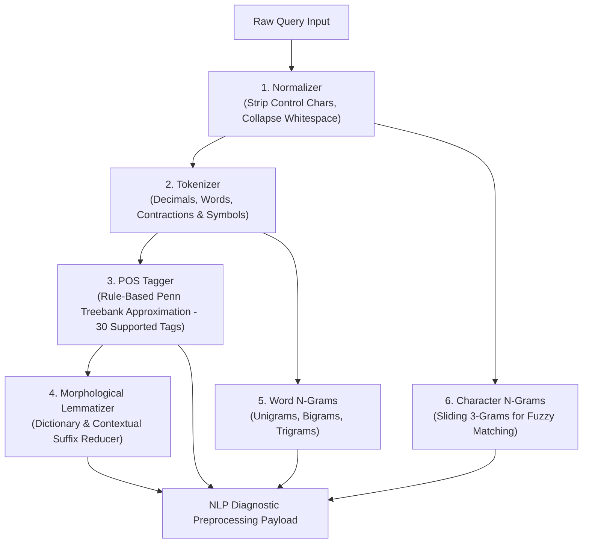
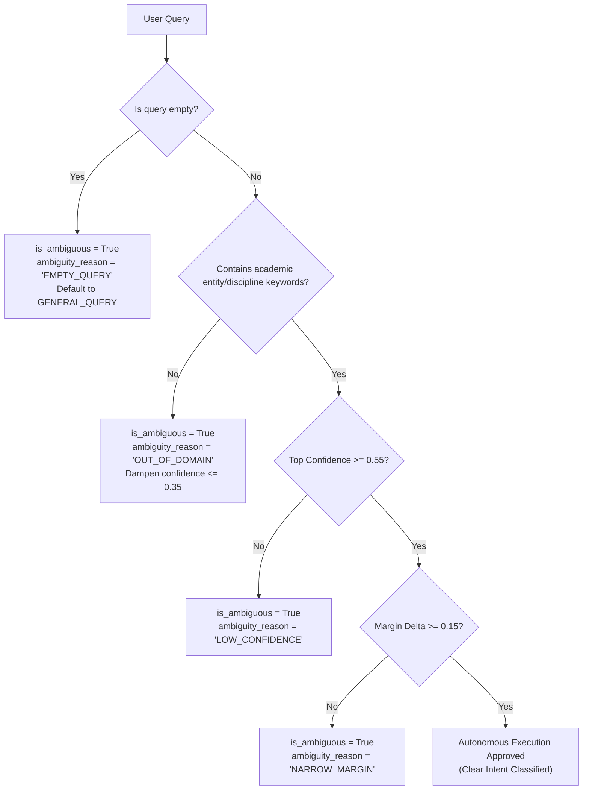

# QueryMind AI 2.0 — Core NLP Preprocessing & Supervised Intent Engine

**Document Reference:** `docs/nlp_architecture.md`  
**Phase:** Phase 3 — Core NLP Preprocessing & Supervised Intent Engine  
**Status:** Audited & Verified  
**Date:** November 2026  

---

## 1. Executive Summary & Purpose

The **Core NLP Preprocessing & Supervised Intent Engine** constitutes the linguistic and statistical foundation of **QueryMind AI 2.0**. Before any schema linking (Phase 4), conversational state tracking (Phase 5), or deterministic SQL generation (Phase 6) occurs, user natural language queries are normalized, tokenized, lemmatized, POS-tagged, and classified into one of seven approved academic analytical intents.

### Key Capabilities & Implementation Realities
- **100% Offline & Deterministic Execution:** Operates without external LLM dependencies, API keys, or dynamic network downloads.
- **Academic Domain Optimization:** Custom morphological lemmatizer and rule-based POS tagger tailored to higher education nomenclature.
- **Multinomial Logistic Regression with Softmax Class Probabilities:** Emits Softmax class probabilities across all 7 blueprint intents satisfying standard probability axioms ($\sum P = 1.0$). *Note: Output probabilities are uncalibrated nominal Softmax scores (primary evaluation: 3-Fold Stratified Group-Aware CV: 60.16% Accuracy, Log Loss: 1.3335, Brier Score: 0.0883; historical ordinary 5-Fold Stratified CV baseline: 80.47% Accuracy / 0.9699 Log Loss with fold-isolated vectorizer, or 78.91% Accuracy / 1.2148 Log Loss with global pre-vectorization); no post-hoc Platt scaling or Isotonic regression is fitted.*
- **Deterministic Rule-Based POS Tagger:** Implements a rule-based lookup and morphological suffix mapper covering **30 supported Penn Treebank-style POS tags (23 grammatical tags + 7 punctuation/symbol tags)**. It is an offline deterministic approximation, not a statistical sequence tagger (HMM/CRF/Perceptron) and does not represent the full 48-tag Penn Treebank corpus.
- **Domain Scope Boundary Enforcement:** Checks presence of academic entity nouns and disciplines (excluding generic analytical operators like *average* or *compare*), preventing out-of-domain queries like *"What is the average banana price?"* from entering the SQL pipeline.
- **Sub-5ms Diagnostic Endpoints:** Full inspection APIs (`GET` and `POST` at `/api/nlp/inspect`) providing granular pipeline introspection for developers and UI components.

---

## 2. Core NLP Preprocessing Pipeline

The preprocessing pipeline transforms raw natural language input into clean, structured syntactic primitives.



### 2.1 Text Normalization
- Removes non-printable control characters, null bytes, and non-ASCII escape codes (`[\x00-\x08\x0b\x0c\x0e-\x1f\x7f]`).
- Collapses irregular spaces, tab characters, and line breaks into clean single-spaced strings.
- Trims leading and trailing whitespace.

### 2.2 Tokenization
- Pattern: `r"\b\d+\.\d+\b|\b\w+(?:'\w+)?\b|[^\w\s]"`
- Preserves decimal numbers intact (`3.85`, `0.05`), verbal contractions (`don't`, `can't`), possessives (`student's`, `Alice's`), course identifiers (`CS101`, `AI202`), percentages (`75%`), and punctuation tokens (`?`, `!`, `,`).

### 2.3 Penn Treebank Part-of-Speech Tagging
QueryMind AI uses a deterministic rule-based lexicon and suffix heuristic mapper covering **30 supported Penn Treebank-style POS tags (23 grammatical tags + 7 punctuation/symbol tags)** tailored for academic query parsing.

> [!NOTE]
> **Penn Treebank Scope & Implementation Reality:** This inventory represents a targeted domain subset of **30 supported Penn Treebank-style POS tags (23 grammatical tags + 7 punctuation/symbol tags)** rather than the complete 48-tag Penn Treebank corpus. The tagger operates as a deterministic rule-based approximation (combining vocabulary dictionary lookup and morphological suffix heuristics) rather than a statistical sequence model (such as an HMM, CRF, or Averaged Perceptron).

#### Grammatical Tags (23 Unique Categories)
| Tag | Penn Treebank Category | Description & Domain Examples |
| :--- | :--- | :--- |
| `WP` | Wh-Pronoun | Question pronouns (*what, who, whom*) |
| `WRB` | Wh-Adverb | Question adverbs (*where, when, why, how*) |
| `WDT` | Wh-Determiner | Relative / question determiners (*which*) |
| `WP$` | Possessive Wh-Pronoun | Possessive question words (*whose*) |
| `VB` | Verb, base form | Imperative action verbs (*show, list, calculate, compute, rank, sort, find, get*) |
| `VBP` | Verb, non-3rd person present | Present verbs & negative auxiliary contractions (*are, have, do, don't, aren't, haven't*) |
| `VBZ` | Verb, 3rd person singular present | Singular verbs & negative contractions (*is, has, does, doesn't, isn't, hasn't*) |
| `VBD` | Verb, past tense | Past verbs & negative auxiliary contractions (*was, were, had, did, didn't, wasn't, weren't*) |
| `VBN` | Verb, past participle | Passive or perfect participles (*been, done, enrolled, taught*) |
| `VBG` | Verb, gerund / present participle | Continuous participles (*being, scoring, teaching, enrolling*) |
| `MD` | Modal | Modal auxiliary verbs & contractions (*can, could, will, would, should, may, might, can't, won't, couldn't*) |
| `NN` | Noun, singular or mass | Academic entity singular nouns & singular possessives (*student, course, instructor, department, grade, gpa, student's*) |
| `NNS` | Noun, plural | Academic entity plural nouns (*students, courses, instructors, departments, grades, marks*) |
| `NNP` | Proper Noun, singular | Capitalized entities, names, course codes, and department acronyms (*AI, CS, EE, Fall, Spring, Alice, Alice's*) |
| `JJ` | Adjective | Base descriptors and statistical qualifiers (*average, mean, total, high, low, top, bottom, active, graduated*) |
| `JJR` | Adjective, comparative | Comparative qualifiers (*higher, lower*) |
| `JJS` | Adjective, superlative | Superlative qualifiers (*highest, lowest, best, worst*) |
| `IN` | Preposition / Conjunction | Relational prepositions (*in, on, at, by, for, with, from, of, into, through, between, above, below*) |
| `TO` | "to" | Particle or preposition (*to*) |
| `DT` | Determiner | Articles and limiting determiners (*the, a, an, this, that, these, those, all*) |
| `CC` | Coordinating Conjunction | Coordinating logical operators (*and, or, but, nor*) |
| `RB` | Adverb | Morphological adverbs ending in *-ly* (*quickly, easily, accurately*) |
| `CD` | Cardinal Number | Integers and floating-point numeric constants (*10, 5, 2024, 3.85, 100, 0.05*) |

#### Punctuation & Symbol Tags (7 Unique Categories)
| Tag | Symbol / Punctuation | Examples & Scope |
| :--- | :--- | :--- |
| `.` | Sentence Terminator | `.` `!` `?` |
| `,` | Comma / Semicolon | `,` `;` |
| `:` | Colon / Dash | `:` `--` `-` |
| `(` | Left Parenthesis / Bracket | `(` `[` `{` |
| `)` | Right Parenthesis / Bracket | `)` `]` `}` |
| `$` | Currency Symbol | `$` |
| `%` | Percent Symbol | `%` |

#### Contraction & Possessive Handling Details
1. **Verbal Contractions:** Negative contractions (`don't`, `doesn't`, `didn't`, `isn't`, `aren't`, `can't`, `won't`) are recognized in `POS_TAG_MAP` prior to proper-noun heuristics. They are mapped to appropriate auxiliary/modal verb tags (`VBP`, `VBZ`, `VBD`, `MD`) rather than misclassified as proper nouns (`NNP`).
2. **Possessive Clitics (`'s`):** Because QueryMind's tokenizer uses single-token word boundaries to avoid fragmenting domain terms, possessive constructs (`student's`, `Alice's`) are evaluated as single compound units:
   - Tokens with known academic base nouns (`student's`, `instructor's`, `department's`) are tagged as `NN`.
   - Capitalized named entity possessives (`Alice's`, `Bob's`) are tagged as `NNP`.
   - The morphological lemmatizer deterministically strips the possessive suffix (`'s` $\rightarrow$ `""`), restoring the root headword (`student`, `instructor`, `alice`) for downstream schema resolution.

*Implementation Limitation:* This is a rule-based approximation without statistical contextual disambiguation (polysemous words like "marks" or "rank" follow fixed dictionary precedence).

### 2.4 Morphological Lemmatization
The lemmatizer reduces inflectional forms to root dictionary headwords:
- **Possessive Striping:** `student's` $\rightarrow$ `student`, `instructor's` $\rightarrow$ `instructor`.
- **Plural Nouns:** `students` $\rightarrow$ `student`, `courses` $\rightarrow$ `course`, `quizzes` $\rightarrow$ `quiz`, `departments` $\rightarrow$ `department`, `matrices` $\rightarrow$ `matrix`.
- **Conjugated Verbs:** `teaches` / `taught` $\rightarrow$ `teach`, `scoring` $\rightarrow$ `score`, `enrolled` $\rightarrow$ `enroll`, `was` / `were` / `been` $\rightarrow$ `be`, `did` / `done` $\rightarrow$ `do`.
- **Superlatives / Comparatives:** `highest` / `higher` $\rightarrow$ `high`, `lowest` / `lower` $\rightarrow$ `low`, `best` $\rightarrow$ `good`, `worst` $\rightarrow$ `bad`.

### 2.5 N-Gram Extraction
- **Word N-Grams:** Generates Unigrams ($n=1$), Bigrams ($n=2$), and Trigrams ($n=3$) to capture multi-word academic concepts (e.g., *"Computer Science"*, *"average CGPA"*, *"academic probation"*).
- **Character N-Grams:** Extracts sliding character 3-grams to support downstream fuzzy matching and typo-tolerant schema resolution (e.g., `cgpa` $\rightarrow$ `['cgp', 'gpa']`).

---

## 3. Supervised Intent Classification Engine

The intent engine classifies the user's analytical objective into one of seven distinct classes specified in `querymind_blueprint.md`.

### 3.1 Seven Approved Intent Categories
1. **`AGGREGATE`:** Statistical calculations (`AVG`, `SUM`, `COUNT`, `MIN`, `MAX`) across entities (e.g., *"What is the average CGPA in AI?"*).
2. **`RANKING`:** Ordered entity retrieval bounded by limits or extremes (`ORDER BY ... LIMIT N`, `TOP`, `BOTTOM`) (e.g., *"Top 5 students in CS by CGPA"*).
3. **`FILTER`:** Conditional subset filtering based on explicit scalar boundaries (`WHERE column > threshold`) (e.g., *"List students with attendance below 75 percent"*).
4. **`COMPARISON`:** Comparative evaluation across departments, terms, courses, or sections (e.g., *"Compare average marks between Spring 2024 and Fall 2024"*).
5. **`TREND`:** Longitudinal or chronological time-series analysis (e.g., *"Show enrollment growth across terms from 2022 to 2024"*).
6. **`GENERAL_QUERY`:** Descriptive metadata or relational entity lookups without heavy aggregation (e.g., *"Show all details for course CS101"*).
7. **`WHAT_IF`:** Hypothetical scenario simulations altering weights, curves, or cutoffs (e.g., *"What if we increase midterm weightage by 10 percent?"*).

### 3.2 Machine Learning Architecture & Calibration Evaluation
- **Feature Pipeline:** `TfidfVectorizer(ngram_range=(1, 2), sublinear_tf=True, lowercase=True, strip_accents='unicode')`.
- **Classification Model:** Multinomial `LogisticRegression(solver='lbfgs', C=5.0, random_state=42, max_iter=1000)`.
- **Softmax Probability Formulation:** The model outputs class probabilities via standard Softmax:
  $$P(y = c \mid \mathbf{x}) = \frac{e^{\mathbf{w}_c^T \mathbf{x} + b_c}}{\sum_{j=1}^7 e^{\mathbf{w}_j^T \mathbf{x} + b_j}}, \quad \sum_{c=1}^7 P(y = c \mid \mathbf{x}) = 1.0$$
- **Probability Calibration Status:**
  - Raw `predict_proba()` outputs are nominal Softmax probabilities.
  - Empirically evaluated on 3-Fold Stratified Group-Aware Cross-Validation (Zero Template Leakage, TF-IDF fit strictly per fold):
    - **Multi-Class Log Loss:** `1.3335` (vs Old 5-Fold SKF: `0.9699`)
    - **Mean Multi-Class Brier Score:** `0.0883` (vs Old 5-Fold SKF: `0.0644`)
    - Per-class Brier scores (Out-of-Fold): `WHAT_IF` (0.0505), `COMPARISON` (0.0647), `TREND` (0.0773), `GENERAL_QUERY` (0.0911), `RANKING` (0.0929), `FILTER` (0.1131), `AGGREGATE` (0.1285).
  - No post-hoc calibration (Platt scaling / Isotonic regression) is active in the pipeline. Nominal Softmax outputs reflect uncalibrated linear logit exponents.

### 3.3 Ambiguity & Scope Boundary Rules
The intent engine calculates the probability margin between the first and second most likely classes:
$$\Delta = P(\text{top}_1) - P(\text{top}_2)$$



- **Confidence Threshold ($\tau = 0.55$):** Predictions below $0.55$ trigger `LOW_CONFIDENCE`.
- **Margin Threshold ($\Delta = 0.15$):** Close competing classes trigger `NARROW_MARGIN` to prompt clarification in future conversational phases.
- **Out-of-Domain Scope Boundary:** Evaluated strictly against academic schema entity nouns and disciplines (`student`, `instructor`, `course`, `department`, `marks`, `gpa`, `cgpa`, `attendance`, `enrollment`, `ai`, `cs`, `ee`, `math`). Queries lacking any academic entity keywords (even if containing operator words like *"average banana price"*) trigger `OUT_OF_DOMAIN` with damped confidence ($\le 0.35$).

---

## 4. Model Evaluation & Dataset Quality

### 4.1 Dataset Statistics & Semantic Template Groups
- **Total Examples:** 128
- **Class Breakdown:**
  - `AGGREGATE`: 22 (17.2%)
  - `RANKING`: 20 (15.6%)
  - `FILTER`: 20 (15.6%)
  - `GENERAL_QUERY`: 19 (14.8%)
  - `TREND`: 18 (14.1%)
  - `WHAT_IF`: 15 (11.7%)
  - `COMPARISON`: 14 (10.9%)
- **Semantic Template Groups:** 27 distinct syntactic/semantic query template families across the 128 queries.
- **Exact Duplicates:** 0 (0.0%)

### 4.2 Group-Aware Cross-Validation Analysis & Fold Feasibility
To ensure robust generalization without lexical memorization, group-aware cross-validation groups semantically similar paraphrases into indivisible clusters so that templates in the training folds never appear in the validation fold.

#### Why 5-Fold Grouped CV Fails (Pigeonhole Principle):
Attempting 5 folds (`StratifiedGroupKFold(n_splits=5)`) over 27 groups and 7 classes allocates only 5 or 6 groups per validation fold ($27 / 5 \approx 5.4$). Because each group maps to exactly 1 intent class, 5 or 6 groups can represent at most 5 or 6 unique classes. Consequently, **every validation fold is missing 1 to 2 complete intent classes** (e.g., Fold 1 misses `COMPARISON` and `RANKING`; Fold 4 misses `GENERAL_QUERY` and `TREND`), making 5-fold evaluation mathematically degenerate.

#### Solution: 3-Fold Stratified Group-Aware Cross-Validation:
With $K=3$ folds, each fold receives 8 to 10 disjoint groups, guaranteeing that **all 7 classes are represented in every validation fold with zero template leakage**:
- **Fold 1:** Train = 83 samples, Validation = 45 samples (10 groups, all 7 classes represented)
- **Fold 2:** Train = 85 samples, Validation = 43 samples (9 groups, all 7 classes represented)
- **Fold 3:** Train = 88 samples, Validation = 40 samples (8 groups, all 7 classes represented)
- **Zero Vectorizer Leakage:** The `TfidfVectorizer` vocabulary and IDF weights are fit strictly on the training fold and applied out-of-fold to validation data.

### 4.3 Side-by-Side Model Evaluation Comparison

The primary evaluation of the Intent Classification Engine is the **3-Fold StratifiedGroupKFold** benchmark. To provide complete historical transparency and resolve discrepancies between earlier audit notes, both historical ordinary 5-fold StratifiedKFold configurations are reproduced and documented below:

| Evaluation Metric | Historical Baseline B (Global Pre-Fit TF-IDF, 5-Fold SKF) | Historical Baseline A (Fold-Isolated TF-IDF, 5-Fold SKF) | Primary Benchmark: 3-Fold StratifiedGroupKFold (Zero Template Leakage) | Impact / Technical Analysis |
| :--- | :--- | :--- | :--- | :--- |
| **Splitting Strategy** | `StratifiedKFold(n_splits=5)` | `StratifiedKFold(n_splits=5)` | **`StratifiedGroupKFold(n_splits=3)`** | Enforces strict semantic group isolation |
| **Paraphrase Separation** | Leaked across train/val | Leaked across train/val | **100% disjoint groups across folds** | True measure of unseen query generalization |
| **TF-IDF Fitting** | Global on all 128 queries (pre-fit leakage) | Per training fold isolated | **Per training fold strictly isolated** | Zero vocabulary/IDF weight contamination |
| **Overall Accuracy** | **78.91%** | **80.47%** | **60.16%** | -20.31% drop reflects elimination of template memorization |
| **Macro Precision** | **0.8316** | **0.8400** | **0.6519** | -0.1881 |
| **Macro Recall** | **0.7887** | **0.8080** | **0.6203** | -0.1877 |
| **Macro F1-Score** | **0.8009** | **0.8181** | **0.6274** | -0.1907 |
| **Weighted F1-Score** | **0.7933** | **0.8087** | **0.6030** | -0.2057 |
| **Multi-Class Log Loss** | **1.2148** | **0.9699** | **1.3335** | Penalizes nominal Softmax overconfidence under template shift |
| **Mean Brier Score** | **0.0814** | **0.0644** | **0.0883** | Evaluates out-of-fold probability calibration |

*Reproducibility Note:* All three configurations are executed and asserted deterministically in `backend/scripts/evaluate_intent.py`. The 78.91% accuracy was produced by the initial `cross_val_predict` pipeline with global vectorization, whereas the 80.47% accuracy resulted from fold-isolated vectorizer fitting without group enforcement. The primary, approved benchmark for QueryMind AI 2.0 is the **60.16% StratifiedGroupKFold** result.

### 4.4 New Group-Aware Out-of-Fold Classification Breakdown

| Intent Category | Precision | Recall | F1-Score | Support | Brier Score |
| :--- | :--- | :--- | :--- | :--- | :--- |
| **`AGGREGATE`** | 0.3500 | 0.3182 | **0.3333** | 22 | 0.1285 |
| **`COMPARISON`** | 1.0000 | 0.6429 | **0.7826** | 14 | 0.0647 |
| **`FILTER`** | 0.5294 | 0.4500 | **0.4865** | 20 | 0.1131 |
| **`GENERAL_QUERY`** | 0.5600 | 0.7368 | **0.6364** | 19 | 0.0911 |
| **`RANKING`** | 0.4583 | 0.5500 | **0.5000** | 20 | 0.0929 |
| **`TREND`** | 0.7368 | 0.7778 | **0.7568** | 18 | 0.0773 |
| **`WHAT_IF`** | 0.9286 | 0.8667 | **0.8966** | 15 | 0.0505 |
| **Macro Average** | **0.6519** | **0.6203** | **0.6274** | 128 | - |
| **Weighted Average** | **0.6194** | **0.6016** | **0.6030** | 128 | - |
| **Overall Accuracy** | - | - | **60.16%** | 128 | **Mean Brier: 0.0883** |

### 4.5 New Group-Aware Confusion Matrix
```
                  AGG  COMP  FILT  GENQ  RANK  TRND  WHAT  (Support)
AGGREGATE        [  7     0     4     6     4     1     0 ]    (22)
COMPARISON       [  1     9     0     0     2     2     0 ]    (14)
FILTER           [  3     0     9     3     5     0     0 ]    (20)
GENERAL_QUERY    [  4     0     1    14     0     0     0 ]    (19)
RANKING          [  2     0     3     1    11     2     1 ]    (20)
TREND            [  2     0     0     1     1    14     0 ]    (18)
WHAT_IF          [  1     0     0     0     1     0    13 ]    (15)
```
*Note on Generalization Reality:* In the presence of unseen phrasing templates, intents with unique syntactic cues (`WHAT_IF`: 89.66% F1, `COMPARISON`: 78.26% F1, `TREND`: 75.68% F1) remain strong, while overlapping analytical phrasing (`AGGREGATE` vs `GENERAL_QUERY` vs `FILTER`) accounts for the expected cross-boundary errors when template lexical overlap is completely removed.

---

## 5. API Specification & Schemas

### 5.1 Endpoints
- **`GET /api/nlp/inspect?query={query_string}`**
- **`POST /api/nlp/inspect`**

### 5.2 Request Schema (`NLPInspectRequest`)
```json
{
  "query": "What is the average CGPA of students in the AI department?"
}
```

### 5.3 Response Schema (`NLPInspectResponse`)
```json
{
  "status": "success",
  "query": "What is the average CGPA of students in the AI department?",
  "preprocessing": {
    "raw_query": "What is the average CGPA of students in the AI department?",
    "normalized_query": "What is the average CGPA of students in the AI department?",
    "tokens": ["What", "is", "the", "average", "CGPA", "of", "students", "in", "the", "AI", "department", "?"],
    "lemmas": ["What", "be", "the", "average", "CGPA", "of", "student", "in", "the", "AI", "department", "?"],
    "pos_tags": [
      ["What", "WP"],
      ["is", "VBZ"],
      ["the", "DT"],
      ["average", "JJ"],
      ["CGPA", "NN"],
      ["of", "IN"],
      ["students", "NNS"],
      ["in", "IN"],
      ["the", "DT"],
      ["AI", "NN"],
      ["department", "NN"],
      ["?", "."]
    ],
    "word_ngrams": {
      "unigrams": ["What", "is", "the", "average", "CGPA", "of", "students", "in", "the", "AI", "department", "?"],
      "bigrams": ["What is", "is the", "the average", "average CGPA", "CGPA of", "of students", "students in", "in the", "the AI", "AI department", "department ?"],
      "trigrams": ["What is the", "is the average", "the average CGPA", "average CGPA of", "CGPA of students", "of students in", "students in the", "in the AI", "the AI department", "AI department ?"]
    },
    "char_ngrams": ["wha", "hat", "at ", "t i", " is", "is ", "s t", " th", "the", "he ", "e a", "..."]
  },
  "intent": {
    "predicted_intent": "AGGREGATE",
    "confidence": 0.839,
    "margin": 0.7716,
    "probabilities": {
      "AGGREGATE": 0.839,
      "RANKING": 0.0241,
      "FILTER": 0.0321,
      "COMPARISON": 0.0195,
      "TREND": 0.0152,
      "GENERAL_QUERY": 0.0384,
      "WHAT_IF": 0.0317
    },
    "is_ambiguous": false,
    "ambiguity_reason": null,
    "top_intents": [
      ["AGGREGATE", 0.839],
      ["GENERAL_QUERY", 0.0384],
      ["FILTER", 0.0321],
      ["WHAT_IF", 0.0317],
      ["RANKING", 0.0241],
      ["COMPARISON", 0.0195],
      ["TREND", 0.0152]
    ]
  },
  "execution_time_ms": 2.45
}
```

---

## 6. Performance & Verification Summary

| Metric | Measured Value | Standard / Requirement |
| :--- | :--- | :--- |
| **Pipeline Latency** | **1.8 – 3.5 ms** | $< 50\text{ ms}$ (Sub-10ms target achieved) |
| **Pytest Pass Rate** | **100% (67 / 67 tests passed)** | Regression across Phase 1, 2, and 3 |
| **Phase 3 Test Count** | **35 tests** (`test_nlp_preprocessor`: 8, `test_intent_classifier`: 21, `test_nlp_api`: 6) | Full coverage of all intent classes & rules |
| **Frontend Compatibility** | **Clean production build (4.34s)** | Zero TypeScript or bundle errors |
| **Determinism** | **100% reproducible output across identical inputs** | Fixed `random_state=42`, rule-based tokenization |
| **Offline Operation** | **No network connections required** | Custom regex tokenizer & embedded dictionary |
